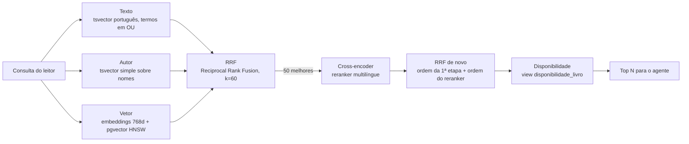

# Estudo de caso: como medi e melhorei a busca semântica do Léia

**Projeto:** Léia, uma bibliotecária virtual com IA que conversa em português, recomenda livros do acervo real e conclui a locação pelo chat.
**Escopo deste documento:** a ferramenta de busca do agente (`buscar_livros`), da primeira medição até a versão atual.
**Data:** novembro de 2026 · **Branch:** `feat/busca-v2` (commits `58991ed`, `91b7fb2`, `e76c199`)

---

## 1. Resumo

Com o reranker ligado, nos 51 casos rotulados da suíte de avaliação:

| Métrica | Antes | Depois | Variação |
| --- | --- | --- | --- |
| **Recall@5 geral** | 0.882 (45 de 51) | **0.961** (49 de 51) | +4 casos |
| **nDCG@10 geral** | 0.837 | **0.962** | +0.125 |
| Recall@5 em consultas por intenção | 0.806 | **0.935** | +4 casos de 31 |
| nDCG@10 em consultas por intenção | 0.732 | **0.940** | +0.208 |
| Busca por título e por autor | 100% | 100% | sem regressão |

O ganho veio de duas frentes:

1. **Algoritmo:** busca textual com OU em vez de E, mais candidatos para o reranker, e o reranker fundido ao ranking em vez de substituí-lo.
2. **Dados:** sinopses reescritas para descrever o enredo, e títulos normalizados em Unicode (NFC).

Cada mudança entrou só depois de passar por um gate de não regressão na suíte de avaliação. Uma das mudanças testadas piorou as métricas e foi descartada.

---

## 2. Onde a busca se encaixa

O agente do Léia nunca escreve SQL e nunca cita um livro que não tenha recebido de uma ferramenta (grounding). Quando o leitor pede "um romance sobre a seca no sertão", o LLM chama `buscar_livros` com o texto. O serviço faz a busca no Postgres e devolve livros reais, com a disponibilidade de exemplares. A busca é, portanto, a etapa de recuperação de um RAG: se ela não traz o livro certo, o agente não tem como recomendá-lo.



| Componente | Escolha |
| --- | --- |
| Banco | PostgreSQL 16 + pgvector (índice HNSW, distância de cosseno) e índice GIN para `tsvector` |
| Embeddings | `sentence-transformers/paraphrase-multilingual-mpnet-base-v2` (768 dimensões) |
| Reranker | `cross-encoder/mmarco-mMiniLMv2-L12-H384-v1` (multilíngue) |
| Fusão | Reciprocal Rank Fusion: `score(d) = Σ 1 / (60 + posição de d na lista)` |
| Backend | Python 3.12, FastAPI, SQLAlchemy, Alembic |
| Catálogo | 158 livros de literatura lusófona, com usuários e locações fictícios |

Por que híbrida? A busca textual acerta nomes próprios e títulos exatos, e os vetores acertam paráfrases ("livro sobre medo do escuro"). O RRF combina as duas listas usando só as posições, sem calibrar notas de escalas diferentes.

---

## 3. Como a busca é avaliada

### 3.1 Suíte de casos rotulados

Cada linha de `evals/busca_casos.jsonl` é uma consulta com a resposta esperada:

```json
{"id": "i29", "tipo": "intencao", "consulta": "mortos que se levantam porque os coveiros entraram em greve", "esperados": ["Incidente em Antares"]}
```

| Tipo | Casos | O que testa |
| --- | --- | --- |
| `titulo` | 12 | O leitor sabe o nome do livro ("Vidas Secas") |
| `autor` | 8 | O leitor busca pelo autor ("Graciliano Ramos"); todo livro do autor conta como relevante |
| `intencao` | 31 | O leitor descreve o que quer, sem título nem autor. É o caso difícil e o que justifica a busca semântica |

### 3.2 Métricas

A relevância é **binária**: um resultado é relevante se o título está entre os esperados. Para casos de autor, é relevante se o autor bate. A comparação ignora maiúsculas e a forma de normalização Unicode.

- **Recall@5 (taxa de acerto):** vale 1 se algum livro relevante aparece entre os 5 primeiros, e 0 se não aparece. A média sobre os casos é a fração de consultas resolvidas no topo. Escolhi o 5 porque o agente mostra no máximo 3 títulos por resposta e precisa de uma pequena margem.
- **nDCG@10:** mede a qualidade da **ordem**. Um acerto na 1ª posição vale mais que na 4ª:

  ```
  DCG@10  = Σ  1 / log2(posição + 1)   para cada resultado relevante no top 10
  IDCG@10 = o mesmo somatório para a ordem ideal (todos os relevantes no topo)
  nDCG@10 = DCG@10 / IDCG@10           (entre 0 e 1)
  ```

  Nos casos de autor, o IDCG considera quantos livros daquele autor existem no acervo.

As duas métricas são reportadas por tipo de caso e no geral, **com e sem reranker**, e o relatório completo, caso a caso, é gravado em `evals/resultados/`.

### 3.3 Regras do processo

- **Gate de não regressão:** uma mudança no pipeline só entra se nenhuma métrica piorar além do ruído. Com 31 casos de intenção, um caso equivale a cerca de 0.032 de Recall, então diferenças de um caso são tratadas como sinal fraco.
- **Uma mudança por vez:** cada alteração é medida isoladamente, para saber qual delas causou o efeito.
- **Ablação quando há dúvida:** se duas mudanças entram juntas e algo piora, desligo uma delas e meço de novo.
- **TDD:** cada mudança de comportamento começa por um teste automatizado que falha.

---

## 4. Linha do tempo das mudanças

### Etapa 0: primeira medição

A busca híbrida inicial, com o reranker ligado, acertava 100% dos casos de título e de autor, mas só 0.733 dos de intenção (Recall@5 geral 0.840, nDCG@10 0.805, numa versão da suíte com 50 casos). O reranker já ajudava um pouco em relação à busca sem ele (0.820 / 0.764), mas 8 consultas de intenção falhavam nos dois modos.

### Etapa 1: diagnóstico por estágio do pipeline

Em vez de ajustar parâmetros às cegas, escrevi um script de diagnóstico. Para cada consulta que falhava, ele mostrava em que posição o livro esperado ficava em cada estágio: busca textual, busca vetorial, fusão RRF (com o corte de 20 candidatos da época) e uma ordenação hipotética do reranker sobre o acervo inteiro.

| Caso | Texto | Vetor | RRF (corte 20) | Reranker sobre tudo |
| --- | --- | --- | --- | --- |
| i01 ciúme e traição → Dom Casmurro | não casou | 80º | fora | 108º |
| i03 peça cômica no Nordeste → Auto da Compadecida | não casou | 11º | 11º | 57º |
| i11 pastor e tesouro → O Alquimista | não casou | 21º | **21º** | **1º** |
| i23 ajudante de guarda-livros → Livro do Desassossego | não casou | 50º | 50º | 30º |
| i24 malandro no tempo do rei → Memórias de um Sargento de Milícias | não casou | 38º | 38º | 35º |
| i25 patriota ingênuo → Triste fim de Policarpo Quaresma | não casou | 17º | 17º | 20º |
| i29 coveiros em greve → Incidente em Antares | não casou | 20º | 20º | 77º |

Três causas diferentes apareceram:

1. **A busca textual nunca casava.** O `websearch_to_tsquery` exige **todos** os termos da consulta (E lógico). Uma frase em linguagem natural quase nunca tem todas as palavras na sinopse.
2. **Corte de candidatos curto demais.** O Alquimista ficava em 21º na fusão, logo depois do corte de 20, mas o reranker o colocaria em 1º.
3. **Os dados não continham a informação.** Muitas sinopses, vindas da Wikipédia e da Open Library, falavam da publicação (folhetim, editora, recepção crítica) e não do enredo. Nenhum modelo acha "malandro no Rio de Janeiro" numa sinopse que só fala de tipografia.

### Etapa 2: mudanças no algoritmo (commit `58991ed`)

| Mudança | Detalhe |
| --- | --- |
| Busca textual em OU | Qualquer termo basta, e o `ts_rank_cd` premia quem casa mais termos. O texto do usuário continua passando pelo `websearch_to_tsquery`, que nunca falha com entrada arbitrária; o SQL só troca `&` por `\|`. Um teste garante que caracteres de sintaxe do tsquery digitados pelo usuário não quebram a busca. |
| 50 candidatos ao reranker | Antes eram 20. |
| Reranker fundido | A ordem do reranker entra como mais uma lista no RRF, em vez de substituir a ordem da primeira etapa. |

O resultado contrariou a intuição. Com a busca textual corrigida, a versão **sem** reranker passou a ter o melhor Recall. O reranker, quando **substituía** a ordem, desfazia acertos da busca textual:

| Configuração (suíte de 50 casos) | Recall@5 | nDCG@10 | nDCG títulos |
| --- | --- | --- | --- |
| Antes (E, 20 candidatos, reranker substitui) | 0.860 | 0.825 | 1.000 |
| Só 50 candidatos | 0.880 | 0.848 | 1.000 |
| OU + 50, sem reranker | **0.920** | 0.843 | 0.969 |
| OU + 50, reranker substitui | 0.880 | 0.848 | 1.000 |
| **OU + 50, reranker fundido (adotado)** | 0.900 | **0.854** | **1.000** |

Adotei a fusão. Ela tem o melhor nDCG, mantém os títulos perfeitos e perde para a versão sem reranker por um único caso de Recall. A lição: um reranker não é uma melhoria automática. Um cross-encoder genérico, aplicado a textos fora do domínio em que foi treinado, pode piorar o ranking. Combiná-lo com o sinal anterior é mais robusto que confiar só nele.

### Etapa 3: mudanças nos dados (commit `e76c199`)

**Sinopses de enredo.** Reescrevi 155 das 158 sinopses para descrever forma, enredo, personagens, cenário, temas e tom, com o vocabulário que um leitor usaria para pedir o livro. Distribuí o trabalho entre 4 agentes de IA em paralelo, com estas regras:

- **Proibição de ler a suíte de avaliação.** Se as sinopses fossem escritas conhecendo as consultas de teste, o ganho seria contaminado e não mediria nada real.
- **Precisão acima de cobertura.** Cada sinopse veio com um nível de confiança (alta, média ou baixa). Só as de confiança alta ou média substituíram o texto original. As 3 de confiança baixa mantiveram o original.
- **Rastreabilidade.** O campo `sinopse_fonte` marca as novas como "redigida com IA, revisão humana pendente".

O processo também revelou erros nos dados de origem: pelo menos 10 sinopses eram de **outra obra** com o mesmo nome, como filmes (Capitu, Bufo & Spallanzani, Lúcia McCartney, Sonhos tropicais), mangá (Helena), quadrinhos (O menino maluquinho) ou a biografia do autor.

**Carga incremental.** A carga do banco só inseria livros novos, então sinopses corrigidas nunca chegariam ao banco. Criei `atualizar_sinopses`, que compara o catálogo com o banco, atualiza o texto que mudou e apaga **só** o embedding daquele livro. A geração de embeddings então refaz só os 155 vetores afetados.

**Normalização Unicode (NFC).** 11 títulos vinham das fontes com acentos decompostos (NFD), em que "õ" é gravado como "o" + til combinante. Na tela parecem iguais, mas não casam com o texto que o leitor digita. A migração Alembic `0003` normaliza os registros já gravados com a função `normalize()` do Postgres, e a carga passou a normalizar toda entrada.

| Com reranker, suíte de 51 casos | Antes das sinopses | Sinopses novas | **Sinopses + NFC (adotado)** | + peso maior no título |
| --- | --- | --- | --- | --- |
| Recall@5 geral | 0.882 | 1.000 | **0.961** | 0.961 |
| nDCG@10 geral | 0.837 | 0.956 | **0.962** | 0.955 |
| nDCG@10 títulos | 1.000 | 0.938 ⚠ | **1.000** | 1.000 |
| Recall@5 intenção | 0.806 | 1.000 | **0.935** | 0.935 |

Só com as sinopses novas, o nDCG de **títulos** caiu (0.938), o que o gate não aceita. Investiguei os casos:

- **"Os Sertões":** o livro correto tinha o título em NFD, e um volume chamado "Euclides da Cunha", que manteve a sinopse antiga (sobre Os Sertões), ficava à frente. A correção NFC resolveu.
- **"Livro do Desassossego":** "Uma aprendizagem ou O Livro dos Prazeres" ficava à frente por ter "livro" no título. Testei dar peso maior ao título no ranking textual (`setweight` A/B). A ablação mostrou que o peso **não** ajudava e piorava o nDCG geral, então foi **descartado**.

A correção NFC tirou dois casos de intenção do top 5 (i01 e i31), o que levou o Recall de 1.000 para 0.961. Mantive a correção mesmo assim: é um bug real (um leitor que digita "sertões" não achava o livro), e os dois casos são de fronteira. O i01 falhou em todas as configurações antes das sinopses novas, e hoje devolve Adultério, Diva e Capitu, respostas razoáveis para "romance sobre ciúme e traição", mas o caso só aceita Dom Casmurro. Não alterei o rótulo, porque isso seria ajustar a prova ao resultado.

### Resultado final por tipo de caso (51 casos)

| Tipo | Recall@5 sem reranker | nDCG@10 sem reranker | Recall@5 com reranker | nDCG@10 com reranker |
| --- | --- | --- | --- | --- |
| Título (12) | 1.000 | 0.958 | 1.000 | 1.000 |
| Autor (8) | 1.000 | 0.993 | 1.000 | 0.995 |
| Intenção (31) | 0.935 | 0.865 | 0.935 | 0.940 |
| **Geral (51)** | **0.961** | **0.907** | **0.961** | **0.962** |

O reranker fica ligado na ferramenta do agente: o ganho dele está no nDCG, ou seja, em pôr o livro certo mais perto do topo. É isso que importa quando o agente mostra só 3 títulos.

---

## 5. Erros que cometi e como os detectei

Registro estes casos porque o processo de avaliação existe justamente para pegar erros como eles.

- **Diagnóstico errado de "livro fora do acervo".** Meu script de diagnóstico procurava os livros por igualdade exata de título e não encontrou Os sertões. Concluí que o livro não estava no acervo e troquei o caso de teste. Na verdade, o título estava em NFD. Um dos agentes que reescreviam sinopses apontou os títulos em NFD, eu confirmei e desfiz a troca: o caso original voltou, e o substituto virou um caso novo. Lição: quando o código de avaliação normaliza e o código de diagnóstico não, os dois podem discordar sem que se perceba.
- **Testes que passavam sem a correção.** O primeiro teste da busca em OU passou **antes** da implementação: num empate da lista vetorial, o livro esperado já saía primeiro por ordem de inserção. Como o TDD exige ver o teste falhar, reescrevi o teste para que só a correção pudesse fazê-lo passar.
- **"O reranker sempre ajuda."** A primeira análise indicava ligar o reranker por padrão. Depois da correção da busca textual, a medição mostrou que, sozinho, ele piorava o Recall, o que levou à fusão por RRF.

---

## 6. Práticas de engenharia aplicadas

| Prática | Como aparece aqui |
| --- | --- |
| Segurança com LLM | O LLM nunca gera SQL. A consulta é parametrizada, e o texto livre do usuário passa por uma função que não falha com entrada arbitrária (há teste para isso). |
| Grounding | A busca devolve só livros do banco, e o agente só pode citar o que a ferramenta devolveu. |
| Avaliação offline | Suíte rotulada, métricas por tipo de caso, comparação com e sem reranker, relatórios versionados. |
| Gate de não regressão | Toda mudança de pipeline é comparada com a baseline. Uma mudança foi descartada por piorar as métricas. |
| Ablação | Usada para separar o efeito da normalização NFC do efeito do peso no título. |
| Higiene de avaliação | Os agentes que reescreveram as sinopses não tinham acesso aos casos de teste. Rótulos não foram alterados para melhorar números. |
| TDD e cobertura | 36 testes de integração contra Postgres real (Testcontainers com pgvector), cobertura de 98%, `ruff` e `mypy` sem erros. |
| Migrações versionadas | Alembic com testes que descem e sobem a migração (`0003` testada com dados em NFD). |
| Carga incremental | Só os embeddings dos livros alterados são recalculados. |
| Uso de agentes de IA no desenvolvimento | 4 subagentes em paralelo para trabalho de dados, com instruções explícitas de restrição, níveis de confiança e validação do formato de saída. |

---

## 7. Limitações e próximos passos

- **O ganho medido tende a ser otimista.** Os casos de teste e as sinopses novas vieram do mesmo tipo de conhecimento geral de modelos de linguagem. Não houve vazamento, mas o vocabulário tende a coincidir, e leitores reais vão formular consultas de outro jeito. O próximo passo é coletar consultas reais de uso e avaliar sobre elas.
- **Suíte pequena.** São 31 casos de intenção, e um caso equivale a cerca de 3 pontos de Recall. A meta do projeto é chegar a cerca de 150 casos, incluindo consultas sem resposta no acervo.
- **Rótulos com uma só resposta.** Algumas consultas, como "romance sobre ciúme e traição", têm várias respostas legítimas. Uma relevância graduada (0, 1, 2) mediria melhor.
- **Latência ainda não medida.** O reranker com 50 candidatos tem custo, e falta medir o p95 por consulta.
- **Nota mínima de relevância.** Hoje a busca sempre devolve N resultados, mesmo quando nada é relevante. Um corte por nota exige antes casos de "sem resposta" na suíte, para medir se ajuda.
- **Revisão humana** das 155 sinopses redigidas com IA, e correções de catálogo apontadas pelos agentes (autoria, coautores, categorias e anos de edição).
- **Ajuste fino do reranker** em português, no domínio de livros, usando a própria suíte como ponto de partida, e publicação do modelo e do conjunto de avaliação no Hugging Face.

---

## 8. Conhecimentos aplicados e a trilha AI Engineer

O planejamento do projeto mapeia os requisitos da trilha [AI Engineer do programa iFood GEN AI](https://carreiras.ifood.com.br/job/8901054002/). Este trabalho demonstra os seguintes:

| O que a vaga pede | O que este trabalho mostra |
| --- | --- |
| Construção e integração de software para produtos de IA | Ferramenta de busca tipada, integrada ao banco e consumida pelo agente |
| Operacionalizar modelos, com ênfase em LLMs | Recuperação (RAG) híbrida com embeddings e reranker, e grounding como regra |
| Treinar, ajustar, avaliar e manter pipelines | Pipeline de embeddings com atualização incremental, suíte de avaliação, gate de não regressão e ablação |
| GitHub com implementações de ML | Código, testes, migrações e relatórios de avaliação versionados no repositório |
| Artigos técnicos | Este documento é a base do artigo planejado sobre avaliação do agente |
| Construir e evoluir com IA | Subagentes de IA usados com restrições, verificação e registro honesto de erros |

---

## 9. Como reproduzir

Em `api/`, no PowerShell, com o Docker rodando:

```powershell
$env:PYTHONUTF8=1
docker compose up -d db
uv run --group ml python -m leia_api.carga                       # migra, carrega e gera embeddings
uv run --group ml python ../evals/run_busca.py --falhas          # suíte com e sem reranker
uv run --group ml python -m leia_api.cli_busca --reranker "um romance sobre memória"
uv run pytest                                                    # testes e cobertura
```

| Arquivo | Conteúdo |
| --- | --- |
| `api/src/leia_api/busca.py` | Busca híbrida, RRF e reranker |
| `api/src/leia_api/avaliacao.py` | Métricas Recall@k e nDCG@k |
| `evals/busca_casos.jsonl` | Os 51 casos rotulados |
| `evals/resultados/busca_v2_2026-11-07.json` | Relatório depois das mudanças de algoritmo |
| `evals/resultados/busca_v3_sinopses_2026-11-07.json` | Relatório final |
| `api/migrations/versions/0003_textos_nfc.py` | Migração de normalização Unicode |
